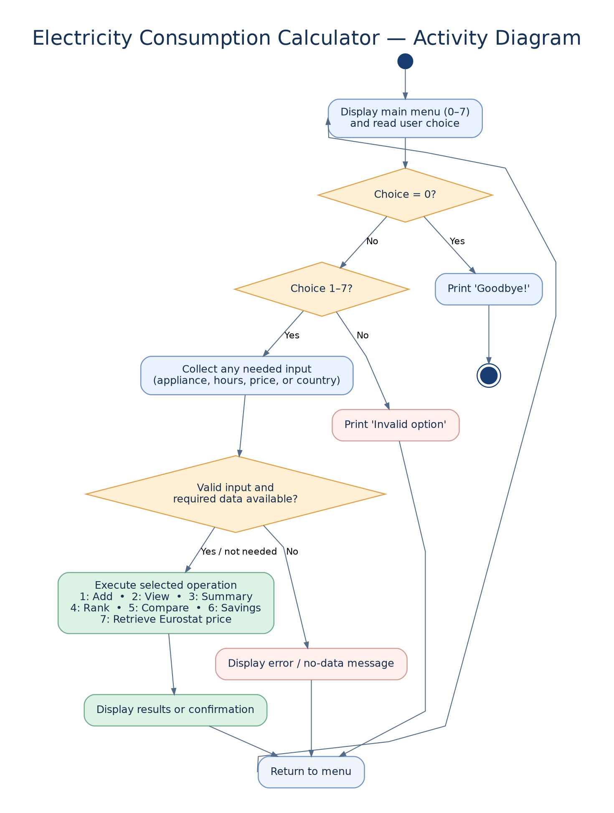
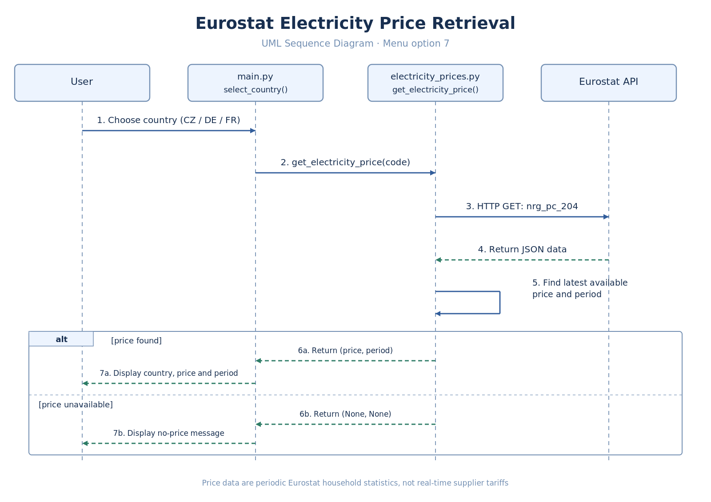

# Electricity Consumption Calculator

A Python command-line application that helps users estimate electricity consumption and costs for household appliances, compare appliances, and explore potential energy savings.

The application supports manual electricity prices and retrieves household electricity price data from the Eurostat API.

## Purpose

The purpose of this project is to help users understand how much electricity their household appliances consume and how daily usage affects electricity costs.

The program allows users to identify appliances with higher operating costs, compare appliances, and estimate potential savings by reducing daily usage hours.

## Features

- Add and view multiple household appliances.
- Calculate electricity consumption in kWh.
- Calculate electricity costs for different time periods.
- Display total monthly consumption and cost.
- Rank appliances by monthly electricity cost.
- Compare the monthly costs of two appliances.
- Estimate potential monthly savings from reduced usage.
- Retrieve electricity prices from the Eurostat API.
- Select Czech Republic, Germany, or France.
- Display the electricity price and reporting period.
- Use a selected country's electricity price in subsequent calculations.
- Allow manual electricity price entry when no country is selected.
- Validate appliance names, power, and daily usage hours.
- Handle invalid manual prices and appliance selections.
- Run automated calculation tests using pytest.

## Inputs and Outputs

### Inputs

- Appliance name.
- Appliance power in watts (W).
- Daily usage in hours.
- Electricity price per kWh.
- Country selection for Eurostat price retrieval.
- Appliance selection for comparisons and savings calculations.
- New daily usage hours for savings simulations.

### Outputs

- Estimated electricity consumption in kWh.
- Estimated electricity costs.
- Monthly consumption and cost summaries.
- Appliances ranked by monthly cost.
- Monthly cost difference between two appliances.
- Potential monthly electricity savings.
- Eurostat electricity price and reporting period.
- Error messages when invalid input is entered.

## Calculation Logic

Electricity consumption is calculated using:

**Consumption (kWh) = Power (W) / 1000 × Hours**

Electricity cost is calculated using:

**Cost = Consumption (kWh) × Electricity price per kWh**

Monthly calculations assume 30 days.

Yearly calculations assume 365 days.

### Example

Consider a television with:

- Power: 100 W
- Daily usage: 5 hours
- Electricity price: 0.30 per kWh

Daily consumption:

100 / 1000 × 5 = 0.5 kWh

Monthly consumption:

0.5 × 30 = 15 kWh

Monthly cost:

15 × 0.30 = 4.50

The same calculation logic is used for appliance rankings, comparisons, and savings simulations.

## Program Logic

The application uses an interactive command-line menu.

1. The user starts the program.
2. The main menu is displayed.
3. The user adds an appliance or selects an operation.
4. The program reads and validates the required inputs.
5. The appropriate calculation or data retrieval function is called.
6. The result is displayed.
7. The program returns to the main menu until the user exits.

When the user selects a country, the program requests household electricity price data from Eurostat.

If a valid price is retrieved, the program stores it for subsequent cost calculations.

If no country price has been selected, the user can enter an electricity price manually.

## Program Diagrams

Two diagrams describe the program logic and its interaction with the Eurostat API.

### Activity Diagram

The activity diagram illustrates the main program flow, including menu navigation, input validation, calculations, and returning to the main menu.



### Sequence Diagram

The sequence diagram illustrates the interaction between the user, the application, and the Eurostat API when retrieving electricity prices.



The diagram files are stored in `docs/diagrams/`.

## Installation and Usage

### Requirements

- Python 3
- Internet connection for Eurostat price retrieval
- `requests` Python library

### Installation

1. Clone or download this repository.
2. Open a terminal in the project directory.
3. Install the required library:

```bash
python -m pip install requests
```

### Running the Program

Run:

```bash
python main.py
```

The following interactive menu will appear:

```text
=== Electricity Consumption Calculator ===
1. Add appliance
2. View appliances
3. Monthly consumption summary
4. Rank appliances by monthly cost
5. Compare two appliances
6. Calculate potential savings
7. Select country and retrieve electricity price
0. Exit
```

Follow the instructions in the terminal.

Choose option `0` to exit the application.

## Electricity Price Data

The program retrieves electricity price data from the Eurostat dataset `nrg_pc_204`.

Supported countries:

- Czech Republic (CZ)
- Germany (DE)
- France (FR)

The retrieved data represents household electricity prices in EUR/kWh, including taxes, for the annual consumption band of 2,500–4,999 kWh.

The program uses the most recent available reporting period returned by its API query.

Eurostat publishes statistical electricity price data periodically. These values are not real-time supplier tariffs or personalized electricity bills.

When a Eurostat electricity price is selected, calculated costs are expressed in EUR.

When a price is entered manually, costs use the same currency unit as the entered price.

## Automated Tests

The project uses `pytest` for automated testing.

The automated tests are stored in:

`tests/test_calculator.py`

Four automated tests have been implemented:

1. Monthly electricity consumption calculation.
2. Monthly electricity cost calculation.
3. Zero daily usage.
4. Yearly electricity consumption calculation.

These tests compare the calculation results against known expected values.

### Running All Tests

Install pytest if necessary:

```bash
python -m pip install pytest
```

Run all tests using the main test script:

```bash
python test_main.py
```

Alternatively, the test suite can be executed directly using:

```bash
python -m pytest -v
```

All four automated calculation tests have passed successfully.

### Testing Documentation

The testing strategy, rationale, example inputs and outputs, manual test scenarios, and testing limitations are documented in:

**[Testing Documentation](docs/tests.md)**

## Input Validation

The program includes input validation and error handling for common user mistakes.

Examples include:

- Rejecting empty appliance names.
- Rejecting non-numeric appliance power values.
- Rejecting appliance power values that are zero or negative.
- Restricting daily appliance usage to 0–24 hours.
- Rejecting invalid appliance selections.
- Rejecting non-numeric and negative manual electricity prices.
- Rejecting invalid usage hours in savings simulations.
- Preventing savings simulations from increasing usage hours.

Invalid inputs display an error message and generally return the user to the main menu without terminating the application.

## Project Structure

```text
semestral-work-ite/
├── src/
│   ├── calculator.py
│   └── electricity_prices.py
├── tests/
│   └── test_calculator.py
├── docs/
│   ├── diagrams/
│   │   ├── activity_diagram.png
│   │   └── sequence_diagram.png
│   └── tests.md
├── main.py
├── test_main.py
├── README.md
└── .gitignore
```

### Main Files

- `main.py` — Command-line interface, appliance management, menu navigation, and input validation.
- `src/calculator.py` — Electricity consumption and cost calculation functions.
- `src/electricity_prices.py` — Eurostat API integration.
- `tests/test_calculator.py` — Automated calculation tests.
- `test_main.py` — Single entry point for running all automated tests.
- `docs/tests.md` — Testing approach, examples, and results.
- `docs/diagrams/` — Program activity and API interaction diagrams.
- `README.md` — Project overview, installation, usage, and limitations.

## Limitations

- Only three countries are supported through the country-selection menu.
- Eurostat data provides statistical reference prices, not real-time electricity tariffs.
- Appliance data is stored in memory and is lost when the program closes.
- Monthly calculations assume 30 days.
- Yearly calculations assume 365 days.
- Electricity consumption estimates assume constant appliance power during the entered usage hours.
- Fixed electricity charges and personalized supplier tariffs are not included.
- An internet connection is required for Eurostat API requests.
- Automated tests currently focus on calculation functions and do not cover API integration or all interactive menu operations.
- Some unusual input values and exceptional conditions may not be handled.

## Project Status

The core command-line application has been implemented.

Completed components include:

- Electricity consumption and cost calculations.
- Multiple-appliance management.
- Monthly electricity consumption summaries.
- Appliance ranking and comparison.
- Potential savings simulations.
- Eurostat API integration.
- Input validation and error handling for common inputs.
- Four automated calculation tests using pytest.
- A single test runner (`test_main.py`).
- Testing documentation (`docs/tests.md`).
- Activity and sequence diagrams.
- Incremental development using Git and GitHub.

Manual tests have been performed on the main menu operations, input validation, and Eurostat electricity price retrieval.

All four automated calculation tests have passed.

The project is undergoing final review and preparation for submission and presentation.
